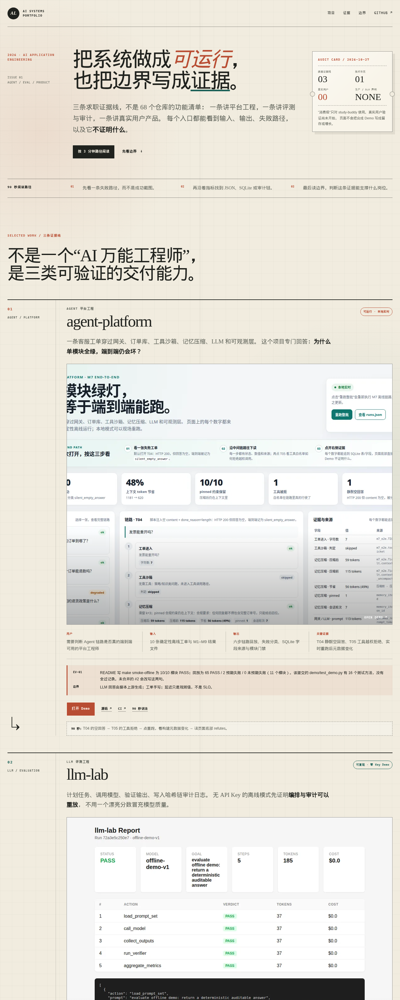

# AI 应用工程作品集

三条证据线各自写明证明什么、不证明什么；页上的数字是上游某次提交里的原文，不是当场重跑。
真实用户为 0，没有生产 SLO，也不把 agent-platform、llm-lab、study-buddy、rag-qa 说成 A。
`make check` 只核对已提交摘录；摘录会过期，`make refresh` 才对比上游默认分支。

> **English TL;DR**: Three evidence lines, each with a stated limit. Every cited number is a quote from a pinned upstream commit, not a fresh rerun. Real users are 0, there is no production SLO, and this site does not grade agent-platform, llm-lab, study-buddy, or rag-qa as A. `make check` matches the committed snapshot only; `make refresh` is the online diff.

STATUS: WORK-IN-PROGRESS — not A yet

还没到 A 的缺口：GitHub About 仍是旧的一行简介（替换文案在文末，PR 改不了 About）。https://aidless.github.io/portfolio-site/ 在 2026-11-16 返回 HTTP 200，正文与当时 `site/index.html`（`42dbb0d`）字节相同，sha256 `c13142cc8e5938c436001ed4deb4bb5d15e841276e0ef5a7c4adebf09cf92ac6`；本分支部署前线上仍是旧页。上游测试总数是引用，没有在本仓重跑；llm-lab 自己的文件互相不一致。

[](https://github.com/aidless/portfolio-site/actions/workflows/pages.yml)

**在线地址**：https://aidless.github.io/portfolio-site/ （GitHub Pages。2026-11-16 实测 HTTP 200，且与当时的 `site/index.html` 字节相同；本分支部署前线上仍是旧页。）



*截图：2026-11-16 本地 `python3 -m http.server 8020 -d site` 后 Chrome headless 1280×3200、`virtual-time-budget=4000` 实截。画面含首屏和 agent-platform 卡上的新摘录句（10/10 模块 PASS、65 PASS、16 个测试方法），以及 llm-lab 报告节的上沿。底部证据账本不在这 3200px 里。下一次改可见文案后，这张图会再次过期。*

这是一个零依赖静态作品集，用三条旗舰证据线说明 AI 应用工程能力：

| 证据线 | 证明什么 | 不证明什么 |
|---|---|---|
| [agent-platform](https://github.com/aidless/agent-platform) | 网关、工具沙箱、记忆压缩、可观测与端到端失败分类 | 真实客服流量、真实 LLM 可用率、生产 SLO |
| [llm-lab](https://github.com/aidless/llm-lab) | 评测编排、输出验证、成本记录与哈希链审计可重放 | 模型质量、榜单名次、生产可靠性 |
| [study-buddy](https://github.com/aidless/study-buddy) | 移动端首次路径、任务状态持久化与明确的隐私选项 | 真实用户留存、消费级通过、云端稳定性 |

rag-qa 作为技术补充，展示混合检索、强制引用、证据不足拒答和离线复测。

## 相关工作 / 对比（真实）

本作品集把自身与"只放 Demo 链接"的典型作品集对照，核心差异是**每条证据线都
同时声明证明/不证明边界**：

| 对照对象 | 现实基础 | 本作品集的差异 |
|---|---|---|
| 只放 Demo 链接的典型作品集 | 常见 GitHub Pages 静态站 | 每条证据线都带"证明什么/不证明什么"边界声明 + fail-closed 检查器 |
| 只放测试数 / badge 的 README | 常见项目 README | 证据数字钉在 `evidence/sources.json` 的上游提交与摘录上，`make check` 离线核对，对不上就失败 |
| 未标注合成 Demo 的评测展示 | 常见评测页 | 所有合成 Demo、离线 Provider、小样本评测与未验证项都在页面主动标注 |
| 声称生产可用的作品集 | 常见求职作品集 | study-buddy 真实用户 0、48h 回访 0/0 如实标注，不声称生产可用 |

**相对基线**：本作品集**不声称**生产可用率、SLO、真实用户留存或消费级通过——
这三条旗舰证据线只证明工程能力，不证明生产成果。

## 当前状态

- 2026-11-16 本地 `make check` 退出码 0（离线，墙钟约 0.07s）。同一天对本地 `http://127.0.0.1:8020/` 做了 GET，新摘录短语都在正文里，并重拍了顶部 1280×3200 截图。没有逐个点完页面上的外链。
- `main` 推送后，Pages workflow 会先跑 `make check`，再发布 `site/`。
- 公开 Pages 在这次部署前仍是旧页，见文首的 sha256。
- study-buddy 当前真实用户为 **0**，首任务完成和 48 小时回访均为 **0/0**。
- 所有合成 Demo、离线 Provider、小样本评测和未验证项都在页面中主动标注。上游四个仓库都不标成 A。

## 快速开始

```bash
git clone https://github.com/aidless/portfolio-site.git
cd portfolio-site
python3 -m http.server 8020 -d site
# 打开 http://127.0.0.1:8020/
```

## 安装（零依赖，无构建）

本仓库是**零依赖静态站点**，无需安装任何包或构建工具。直接克隆后即可服务
`site/`（见"快速开始"）。`make check` 只用 Python 3 标准库。`make refresh`
同样只用标准库，但会访问 GitHub。

## 本地运行

```bash
python3 -m http.server 8020 -d site
# open http://127.0.0.1:8020/
```

## 静态检查

```bash
make check      # 离线：check_site.py + evidence/sources.json 对账，并自测「站点丢掉摘录会失败」
make refresh    # 可选、需要网络：重拉上游默认分支和记录在案的开放 PR，只打印差异，不改文件
```

`make check` 不安装依赖、不访问网络。它验证三张项目卡、页上的摘录短语、全部本地资源、零 JavaScript、零 CDN、响应式/打印/减少动效契约，以及 llm-lab 报告中的 5 个 PASS 标记。页上的 `419 passed` 与 `488 passed` 必须同时在，因为上游同一次提交里两处写法不一致。

## 测试

```bash
cd portfolio-site
make check    # 离线入口。check_site.py 打出 3 行 PASS；provenance 再打 1 行 PASS
```

`tools/check_site.py` 与 `tools/check_provenance.py` 都是标准库、可离线跑。`tests/` 里有 pytest（装了 pytest 时 `make eval` 会跑）。静态契约断言：

- **site contract**：3 张旗舰卡、4 行证据、全部本地资源、边界声明存在。
- **zero JS/CDN**：零 `<script>`、零外部资源、响应式/打印/减少动效 CSS 契约。
- **llm-lab evidence**：报告中 5/5 PASS、成本 $0.000000、5 个可见报告徽章。

## Fail-closed guarantee

`make check` returns **exit 1** when either checker fails. `tools/check_site.py` returns **exit 1** on any contract violation — missing file,
missing element id, stale four-demo copy (`FORBIDDEN_TEXT`), wrong flagship-card count,
a `<script>` tag, an external resource, an invalid llm-lab result JSON, or a forbidden
pattern (API key `sk-...`, GitHub token `gh[pousr]_...`, absolute home path `/home/`,
`/Users/`, `C:\`). `tools/check_provenance.py` returns **exit 1** when a site phrase,
snapshot, or `evidence/sources.json` value drifts, including the withdrawn strings
`16/16` and `391 passed`. A bad site produces **FAIL**, never a silent pass.
Both checkers are zero-dependency, deterministic, and offline-runnable. CI
(`.github/workflows/pr-checks.yml` and `pages.yml`) runs `make check`.

## 证明什么 / 不证明什么

**证明：** 站点按静态契约构建，`make check` 在本地通过；三张旗舰卡与摘录短语存在；
零外部依赖与零 JS 的静态契约成立；llm-lab 离线报告的 5 个 PASS 标记可见；
页上每个上游数字都能在 `evidence/snapshots/` 里对上一次提交的原文或 JSONL 计数。

**不证明：** 任何真实用户留存（study-buddy 当前真实用户为 **0**，48 小时回访
**0/0**）；生产可用率或 SLO（站点未接入任何监控）；截图只证明视觉与交互路径，
不证明用户留存或生产可靠性。所有合成 Demo、离线 Provider、小样本评测与未
验证项都在页面中主动标注。

## 复现

```bash
cd portfolio-site
make check    # 离线
python3 -m http.server 8020 -d site   # 浏览器验收：http://127.0.0.1:8020/
```

`3` 张旗舰卡、`4` 行证据、`5/5` PASS、`$0.000000` 成本均来自
`tools/check_site.py` 对当前 `site/` 的实际断言输出，可在此树复算。

## 图片与证据

`site/assets/` 中三张预览图来自本机 Chromium 截图后转成 WebP；不包含账号、
密钥、真实用户输入或私有数据。`site/evidence/` 只放可公开检查的 llm-lab
离线报告与结果 JSON。截图只证明视觉与交互路径，不证明用户留存或生产可靠性。

## 部署边界

GitHub Pages workflow 会在推送后先运行静态检查，再发布 `site/`。发布结果只由
对应 Actions run、部署记录和公开 HTTPS 响应确认。

## GitHub About（需要在网页上粘贴）

2026-11-16 读到的 About 是：`Public portfolio site for AI application / Agent engineering roles (GitHub Pages)`。

建议换成：

`Zero-dependency static portfolio. Cited numbers are pinned upstream quotes, not fresh reruns. Real users 0. No production SLO. Linked repos are not graded A.`

## License

MIT

## U1 results table (recomputed 2026-11-11)

<!-- figure: docs/screenshot.png (recaptured 2026-11-16, Chrome headless 1280x3200 of http://127.0.0.1:8020/; top of the page only) -->

All values below were recomputed from the committed evidence JSON, and the site
checker was executed locally for this pass.

| Result | Value | Source (path:line) |
|---|---|---|
| Evidence run id | `df0c8ed1379c` | `site/evidence/llm-lab-result.json:2` |
| Model (offline) | `offline-demo-v1` | `site/evidence/llm-lab-result.json:5` |
| Verifier | `structural` | `site/evidence/llm-lab-result.json:6` |
| Steps recorded | 5 | `site/evidence/llm-lab-result.json:7` |
| Step detail entries | 5 | `site/evidence/llm-lab-result.json:9` |
| Verdict labels | pass=5 | `site/evidence/llm-lab-result.json:16` (counted from `steps_detail[].verdict.label`) |
| Total tokens | 185 | `site/evidence/llm-lab-result.json:76` |
| Total cost (USD) | 0.0 | `site/evidence/llm-lab-result.json:77` |

**Quickstart command actually executed for this pass** (exit code 0):

```bash
make check
# python3 tools/check_site.py
# PASS  site contract: 3 flagship cards, 4 evidence rows, local assets, boundaries
# PASS  zero JavaScript, zero CDN, responsive/print/reduced-motion CSS contracts
# PASS  llm-lab evidence: 5/5 PASS, $0.000000, 5 visible report badges
# python3 tools/check_provenance.py --selftest
# PASS  provenance: 22 claims match evidence/sources.json and site/index.html
# PASS  provenance selftest: a site missing the quoted value fails
```

`make refresh` was also run on 2026-11-16. It exited 0: the pinned quotes were still on each default-branch HEAD, and the recorded open-PR expectations still matched. That command needs a network and is not part of `make check`.

The screenshot embedded above is a real local headless-browser capture from
2026-11-16. It shows the top 3200px after the provenance wording change, not
the ledger at the bottom. The offline provider gives
`model: offline-demo-v1` and `total_cost_usd: 0.0` — cost and
quality numbers here are demo artifacts, not production measurements.

## 验收标准与复算

本仓判为合格的条件是 `python3 eval/run_cases.py` 通过率必须为 100%（20/20），且 `make eval` 退出码必须为 0；任何一条失败即判为不合格。题库 `eval/cases.jsonl` 共 20 条，全部 `expr/raises` 题都真调本仓 `tools/check_site.py` 的 API 或真解析 `site/evidence/` 下的数据文件，期望值是现算的，不是抄文档。

| axis | 条数 | 测什么 |
|---|---|---|
| `contract/counts` | 3 | 元素 id 齐备、3 张旗舰卡、3 张预览图 |
| `contract/text` | 3 | 必需文案齐备、杜绝过期四 Demo 文案、4 条 FAQ |
| `resources/local` | 3 | 本地资源存在、越出 `site/` 的路径被拒、外链不误判 |
| `evidence/json` | 3 | `llm-lab-result.json` 的 steps / tokens / cost |
| `evidence/verdicts` | 3 | `all_passed`、5 条 `pass` verdict、报告 5 个 PASS 徽章 |
| `tooling/checker` | 2 | `tools/check_site.py` 退出码 0、stdout 4 次 PASS |
| `contract/css` | 1 | 响应式/打印/减少动效/字体与配色 token 齐备 |
| `raises/parser` | 1 | `SiteParser.feed(None)` 抛 `TypeError`（无入参防御） |
| `raises/resource` | 1 | `check_local_resource(raw=None)` 抛 `AttributeError` |

复算（在本仓根目录执行）：

```bash
python3 eval/run_cases.py            # 必须 20/20；exit 0 才算合格
python3 eval/run_cases.py --selftest # 篡改首条期望值，必须 19/20 变红且 exit 0
make eval                            # run_cases + 既有 pytest（4 passed），exit 0 才算合格
```

`python3 eval/run_cases.py --save` 会把本次结果写入 `eval/run-report.json`（含 `failed_by_axis`），便于逐条对表。失败归因按 axis 汇总，例如：

```text
失败归因（按 axis）：
  contract/counts: 1 条 —— PF-01
  evidence/json: 1 条 —— PF-11
```

改动源码或 `site/` 后，先跑 `python3 tools/check_site.py` 确认静态契约，再跑 `make eval`；若题库变红，按上面 axis 汇总定位到具体 case，其 `verify` 字段就是可单独复跑的最小代码。
