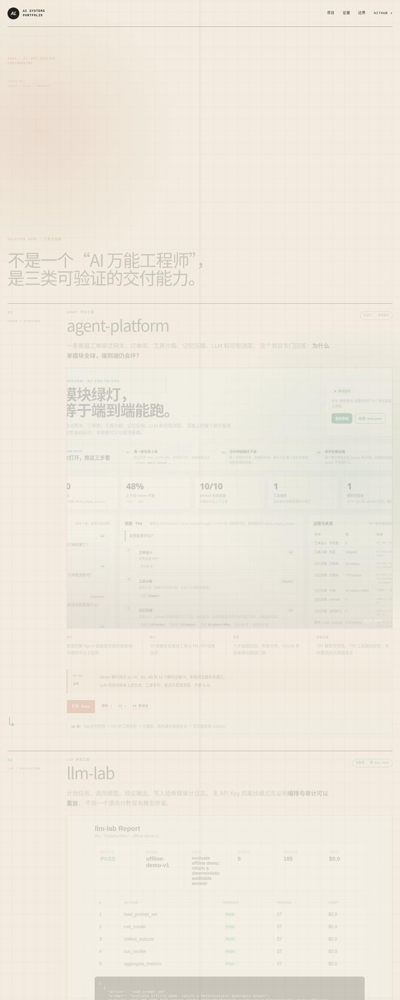

# AI 应用工程作品集

[](https://github.com/aidless/portfolio-site/actions/workflows/pages.yml)

**在线地址**：https://aidless.github.io/portfolio-site/ （GitHub Pages，2026-11-10 实测 HTTP 200）



*截图：2026-11-10 本地 `python3 -m http.server 8020 -d site` 后 Chrome headless 1280×3200 实截（首屏 + agent-platform 卡 + llm-lab 报告节）。页面淡入动画未在 headless 中完全触发，成图偏浅，属如实状态。*

这是一个零依赖静态作品集，用三条旗舰证据线说明 AI 应用工程能力：

| 证据线 | 证明什么 | 不证明什么 |
|---|---|---|
| [agent-platform](https://github.com/aidless/agent-platform) | 网关、工具沙箱、记忆压缩、可观测与端到端失败分类 | 真实客服流量、真实 LLM 可用率、生产 SLO |
| [llm-lab](https://github.com/aidless/llm-lab) | 评测编排、输出验证、成本记录与哈希链审计可重放 | 模型质量、榜单名次、生产可靠性 |
| [study-buddy](https://github.com/aidless/study-buddy) | 移动端首次路径、任务状态持久化与明确的隐私选项 | 真实用户留存、消费级通过、云端稳定性 |

rag-qa 作为技术补充，展示混合检索、强制引用、证据不足拒答和离线复测。

## 相关工作 / 对比（真实）

本作品集把自身与"只放 Demo 链接"的典型作品集对照，核心差异是**每条证据线都
同时声明证明/不证明边界**：

| 对照对象 | 现实基础 | 本作品集的差异 |
|---|---|---|
| 只放 Demo 链接的典型作品集 | 常见 GitHub Pages 静态站 | 每条证据线都带"证明什么/不证明什么"边界声明 + fail-closed 检查器 |
| 只放测试数 / badge 的 README | 常见项目 README | 证据数字（16/16、391 passed、10/12）可由 `tools/check_site.py` 在本树复算 |
| 未标注合成 Demo 的评测展示 | 常见评测页 | 所有合成 Demo、离线 Provider、小样本评测与未验证项都在页面主动标注 |
| 声称生产可用的作品集 | 常见求职作品集 | study-buddy 真实用户 0、48h 回访 0/0 如实标注，不声称生产可用 |

**相对基线**：本作品集**不声称**生产可用率、SLO、真实用户留存或消费级通过——
这三条旗舰证据线只证明工程能力，不证明生产成果。

## 当前状态

- 新版站点已完成本地构建、静态契约检查和浏览器验收。
- `main` 推送后，Pages workflow 会先运行静态检查，再发布 `site/`。
- 当前线上版本以对应 GitHub Actions run 和 Pages HTTPS 响应为准。
- study-buddy 当前真实用户为 **0**，首任务完成和 48 小时回访均为 **0/0**。
- 所有合成 Demo、离线 Provider、小样本评测和未验证项都在页面中主动标注。

## 快速开始

```bash
git clone https://github.com/aidless/portfolio-site.git
cd portfolio-site
python3 -m http.server 8020 -d site
# 打开 http://127.0.0.1:8020/
```

## 安装（零依赖，无构建）

本仓库是**零依赖静态站点**，无需安装任何包或构建工具。直接克隆后即可服务
`site/`（见"快速开始"）。唯一可选工具是 Python 3 标准库的 `http.server` 与
`tools/check_site.py`（同为标准库实现）。

## 本地运行

```bash
python3 -m http.server 8020 -d site
# open http://127.0.0.1:8020/
```

## 静态检查

```bash
python3 tools/check_site.py
```

检查器验证三张项目卡、证据数字、全部本地资源、零 JavaScript、零 CDN、
响应式/打印/减少动效契约，以及 llm-lab 报告中的 5 个 PASS 标记。

## 测试

```bash
cd portfolio-site
python3 tools/check_site.py    # 3 行 PASS（site contract / zero-JS-CDN / llm-lab evidence）
```

本仓库无 pytest 套件——`tools/check_site.py` 是唯一的自动验证入口（零依赖、
确定性、可离线跑）。它断言：

- **site contract**：3 张旗舰卡、4 行证据、全部本地资源、边界声明存在。
- **zero JS/CDN**：零 `<script>`、零外部资源、响应式/打印/减少动效 CSS 契约。
- **llm-lab evidence**：报告中 5/5 PASS、成本 $0.000000、5 个可见报告徽章。

## Fail-closed guarantee

`tools/check_site.py` returns **exit 1** on any contract violation — missing file,
missing element id, stale four-demo copy (`FORBIDDEN_TEXT`), wrong flagship-card count,
a `<script>` tag, an external resource, an invalid llm-lab result JSON, or a forbidden
pattern (API key `sk-...`, GitHub token `gh[pousr]_...`, absolute home path `/home/`,
`/Users/`, `C:\`). A bad site produces **FAIL**, never a silent pass. It is the only
automated verification entry point (zero-dependency, deterministic, offline-runnable).

## 证明什么 / 不证明什么

**证明：** 站点按静态契约构建，检查器在本地通过；三张旗舰卡与证据数字存在；
零外部依赖与零 JS 的静态契约成立；llm-lab 离线报告的 5 个 PASS 标记可见。

**不证明：** 任何真实用户留存（study-buddy 当前真实用户为 **0**，48 小时回访
**0/0**）；生产可用率或 SLO（站点未接入任何监控）；截图只证明视觉与交互路径，
不证明用户留存或生产可靠性。所有合成 Demo、离线 Provider、小样本评测与未
验证项都在页面中主动标注。

## 复现

```bash
cd portfolio-site
python3 tools/check_site.py    # 3 行 PASS
python3 -m http.server 8020 -d site   # 浏览器验收：http://127.0.0.1:8020/
```

`3` 张旗舰卡、`4` 行证据、`5/5` PASS、`$0.000000` 成本均来自
`tools/check_site.py` 对当前 `site/` 的实际断言输出，可在此树复算。

## 图片与证据

`site/assets/` 中三张预览图来自本机 Chromium 截图后转成 WebP；不包含账号、
密钥、真实用户输入或私有数据。`site/evidence/` 只放可公开检查的 llm-lab
离线报告与结果 JSON。截图只证明视觉与交互路径，不证明用户留存或生产可靠性。

## 部署边界

GitHub Pages workflow 会在推送后先运行静态检查，再发布 `site/`。发布结果只由
对应 Actions run、部署记录和公开 HTTPS 响应确认。

## License

MIT
